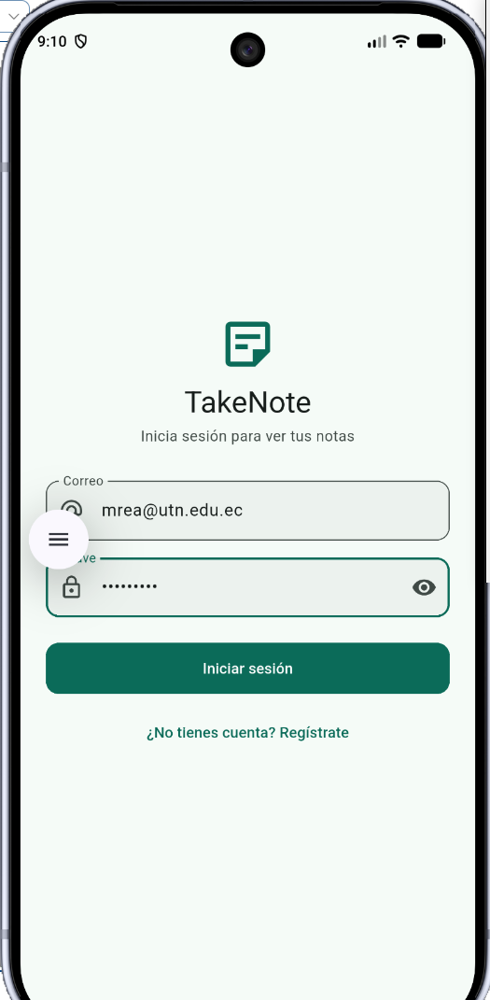
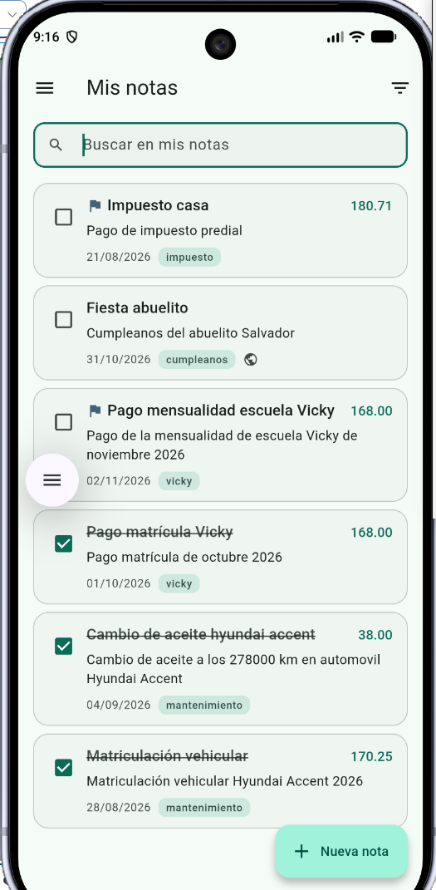
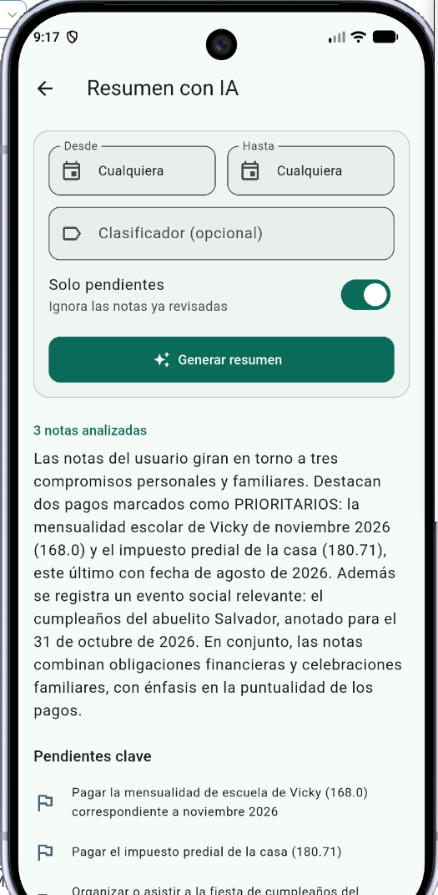
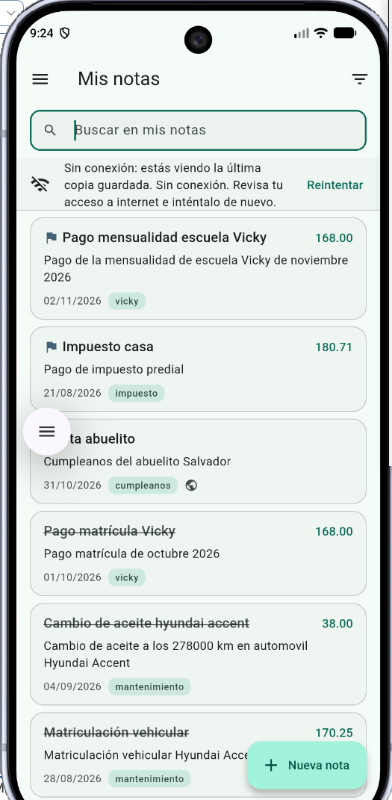

# takenote

Proyecto final - curso CEDIA. Pequeño sistema para gestión de notas personales.

Esta aplicación permite registrar notas de diverso tipo (gastos, recordatorios, cumpleaños, notas informativas, etc.). Cada usuario que se registre podrá tener sus notas personales y también notas de tipo público (las pueden ver todos).

## Capturas de pantalla

- Login:

    

- Lista de notas:

    

- Resumen de las notas mediante IA (se uso DeepSeek):

    

- Datos sin conexión:

    


## Qué incluye

- [X] Registro e inicio de sesión (JWT con backend propio, publicado en un VPS y hecho con Python)
- [X] Lista principal con estados de carga, vacío y error
- [X] Persistencia local que sobrevive al reinicio (solo funciona si ya se hizo login y se perdió la conexión posteriormente)
- [X] Datos remotos protegidos por autorización (mrea@utn.edu.ec)
- [X] Asistente con IA mediante un servidor intermedio, sin claves en la app
- [X] Estado compartido con GetX

## Cómo ejecutarla

Requisitos: Flutter 3.47.6

1. **Backend**:

Está funcionando en un VPS, no requiere administrar nada.

2. **App:**

   ```bash
   flutter pub get
   flutter run
   ```

## APK

Descárgalo desde la sección **Releases** de este repositorio:
[Descargar TakeNote APK](https://github.com/mreap/takenote/releases/download/v1.0.0/takenote-v1.0.0.apk)
Se genera con GitHub Actions al subir una etiqueta `v*` (ver `.github/workflows/release-apk.yml`). Para probarlo, instálalo en un emulador con el backend encendido como se explica arriba.

## Arquitectura

| Carpeta | Función |
| :--- | :--- |
| **app/** | Configuración: rutas, tema, URL y arranque |
| **controllers/** | Estado de las pantallas (GetX) |
| **data/** | Peticiones HTTP y almacenamiento local |
| **models/** | Clases de datos de la API |
| **repositories/** | Operaciones de la API por área |
| **screens/** | Pantallas de la app |
| **widgets/** | Componentes visuales reutilizables |

## Decisión técnica propia

Tomemos como ejemplo la lista de notas. Al abrir "Mis notas", NotasController (en controllers/) pide los datos a NotasRepository (en repositories/). El repositorio llama a ApiClient (en data/), que es el único que habla con el servidor: agrega el token guardado, hace la petición GET /notas con Dio y recibe el JSON. Si algo falla, como no tener conexión o un error 401, ApiClient lo convierte en un ApiException con un mensaje claro. Con el JSON, el repositorio crea objetos Nota (en models/) y se los entrega al controlador. El controlador los guarda en una lista observable (notas) y cambia su estado a "datos", o a "vacío" si no llegó ninguna. En screens/, NotasScreen está envuelta en Obx, así que detecta ese cambio y se redibuja sola, usando NotaCard (en widgets/) para cada nota. Ninguna capa se salta a otra: la pantalla nunca hace peticiones HTTP y el cliente HTTP nunca sabe qué pantalla lo usa.

## Tecnologías


| Paquete | Uso |
| :--- | :--- |
| **get** | Estado reactivo, navegación y registro de dependencias |
| **dio** | Peticiones HTTP a la API |
| **flutter_secure_storage** | Guardar el token de forma segura |
| **get_storage** | Copia local de notas y último usuario |
| **intl** | Formato de fechas y números |
| **mocktail** | Simular repositorios en las pruebas |


## Seguridad

- No hay claves ni secretos en el repositorio (`.env` está en `.gitignore`).
- El token de sesión se guarda con almacenamiento seguro y nunca se imprime.
- La clave de IA, si existe, vive solo en el servidor.

## Créditos

Xavier Mauricio Rea - Universidad Técnica del Norte

